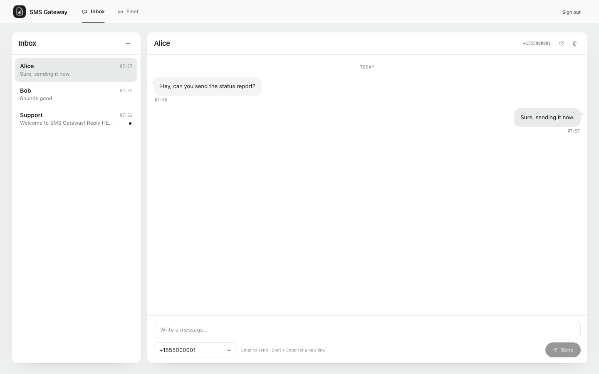
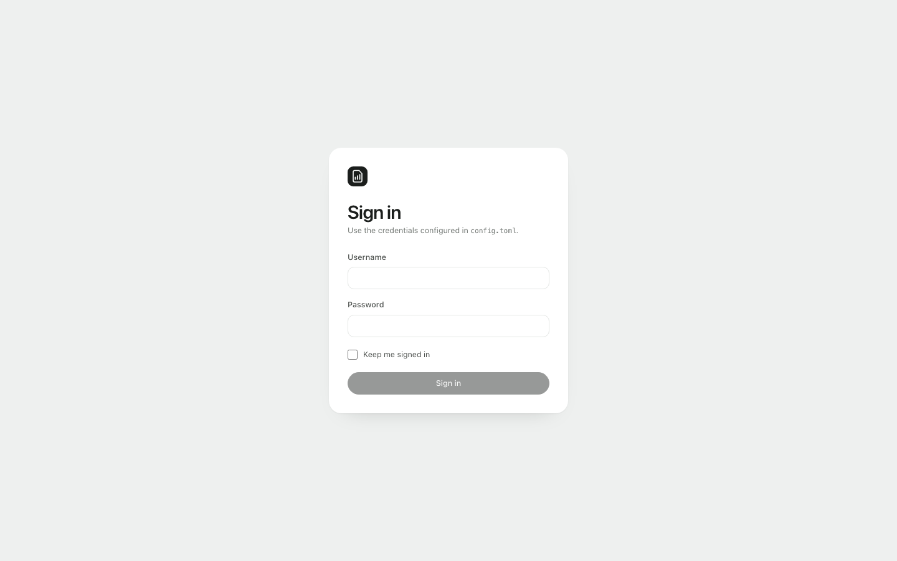
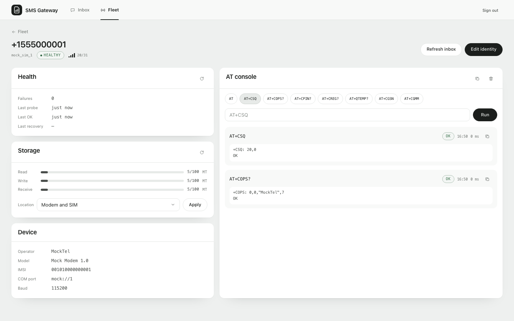

# SMS Gateway

SMS Gateway is a self-hosted web workspace for handling SMS traffic across multiple modems and SIM cards. It keeps conversations, SIM status, and device controls in one place so you can reply faster, monitor line health, and hand messages off to the rest of your stack.

## Why SMS Gateway

- Keep inbound and outbound SMS in a clean, conversation-first workspace.
- Manage multiple SIM cards without losing per-device visibility.
- Check signal, operator, storage, and health status from the same UI.
- Forward messages into your own workflows with webhook support.
- Use raw AT debugging when a device needs closer inspection.

## Interface Preview

### Conversation Workspace

<p align="center">
  
</p>

### More Screens

<table>
  <tr>
    <td width="50%">
      
    </td>
    <td width="50%">
      
    </td>
  </tr>
  <tr>
    <td align="center"><sub>Secure Login</sub></td>
    <td align="center"><sub>SIM Detail and AT Debug</sub></td>
  </tr>
</table>

## Quick Start

1. Copy the example configuration:

```bash
cp config.toml.example config.toml
```

2. Build the frontend:

```bash
cd frontend
pnpm install
pnpm run build
```

3. Start the server:

```bash
cargo run --release -- --config ./config.toml
```

4. Open `http://localhost:8080` in your browser.

## Configuration

- Start with [`config.toml.example`](./config.toml.example).
- Add your modem ports under `[[devices]]`.
- Set the web login, polling interval, and webhook behavior under `[settings]`.
- Set `login_required = false` under `[settings]` to open the web interface without signing in. This also disables API authentication, so use it only on a trusted network.
- For the complete set of available options, use the example config as the reference.

## USB Serial Recovery

For modems initialized at startup, serial I/O errors, command timeouts, and EOF
close the old serial handle and mark the connection disconnected. Subsequent
polling or health checks retry opening the configured `com_port` with the same
baud rate. Each queued command makes up to three opening/initialization attempts,
with two seconds between failed attempts (device deletion commands use one
attempt). Later polling and health checks continue recovery if the device remains
unavailable.

A replacement connection runs the modem initialization commands and restores the
last successfully configured SMS storage before accepting other commands. Runtime
reinitialization also closes the current handle and reopens the configured path.
Commands already attempted on a failed connection return an error instead of being
replayed, since an SMS send or deletion may have succeeded before its response was
lost.

Keep using stable device paths such as `/mnt/usb-serial/android/if02` and
`/mnt/usb-serial/quectel/if02`. The host must make the replacement device nodes
accessible inside the container; the service reopens those paths without a process
restart. Devices absent during initial service startup are not discovered by this
recovery flow.

## Automatic Device SMS Cleanup

Received SMS messages are automatically removed from the selected SIM or modem
storage after their complete contents have been committed to SQLite. Conversation
history remains available in the web interface. No additional setting is required;
cleanup follows the existing `read_sms_frequency` polling interval.

- The first polling cycle after startup also imports and cleans up existing read
  and unread messages. Messages already present in the database are not imported
  or forwarded to webhooks again.
- Database failures leave the device originals intact. Failed or interrupted
  deletions are retried on later polling cycles using durable, per-SIM and
  per-storage acknowledgements. Each device index is checked against its saved
  PDU before deletion so reused indexes cannot authorize deleting a different SMS.
- Multipart messages are removed only after all parts have been assembled and
  saved. Incomplete, malformed, unsupported, or conflicting messages are retained
  on the device and may still require inspection if storage remains full. Sent
  messages and drafts in device storage are also retained.
- A device marked critical solely because SMS storage is full continues importing
  and cleaning up messages. Unrelated critical failures still pause polling.
- Manual SMS refresh uses the same import and cleanup behavior. Deleting a web
  conversation only removes database history; it is independent of device cleanup.

The database migration adds `modem_sms_receipts` automatically on startup. The
acknowledgements are committed in the same transaction as the archived messages
and removed after confirmed device deletion. Webhooks are queued only for newly
archived messages; this does not add guaranteed webhook delivery across crashes.

## License

This project is licensed under the MIT License. See [LICENSE](./LICENSE) for details.
